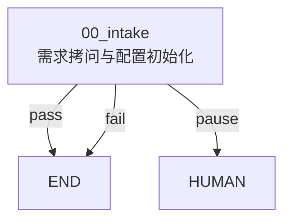

# LOOP.md

> 本文件是 workflow control-plane manifest：它描述当前图、索引、全局策略和配置状态。节点细则不写在这里，必须下沉到 `modules/*`。

## 定位

`writing-loop-harness` 是一个以文本文件为事实源的 Agent 工作流控制平面。

- `LOOP.md` 定义当前 workflow 地图、节点索引、边索引和全局维护协议。
- `modules/*` 定义节点本地 harness，是每个环节的细则事实源。
- `GATE.md` 定义节点检查点和路由 outcome。
- agent 是执行引擎，按图进入 active node 并读取节点本地文件。
- `tools/*` 只是薄辅助层，用于校验结构、同步可视化投影、创建节点五件套。
- `app/*` 是基于 `@xyflow/react` 的自研前端视图层，用来查看控制平面，不是事实源。

本仓库必须独立于任何内容库、发布账号仓库、Obsidian 库、社媒运营项目或历史草稿语料。

## Workflow Goal

当前目标：提供一个轻量、可版本管理、可人工编辑的 agent workflow harness，让人类能像管理 n8n/Dify 工作流一样管理 agent 节点，但事实源是 Markdown 文件和模块目录，而不是平台数据库或 UI。

## Current Graph



## Node Index

| Node | Folder | Purpose | Gate |
|---|---|---|---|
| 00_intake | `modules/00_intake/` | 需求拷问与配置初始化 | `modules/00_intake/GATE.md` |

## Edge Index

| From | Outcome | To | Meaning |
|---|---|---|---|
| 00_intake | pass | END | 当前 loop 配置已经足够指导下一步实现或执行 |
| 00_intake | pause | HUMAN | 需要人类补充高影响决策 |
| 00_intake | fail | END | 初始化被终止，或事实源结构损坏到无法继续 |

## Runtime Policy

Agent 接手后按这个顺序行动：

1. 读根 `AGENTS.md`。
2. 读本文件，确认 workflow 地图和当前配置状态。
3. 根据 active node 进入 `modules/<node>/`。
4. 依次读该节点的 `AGENTS.md`、`NODE.md`、`SYSTEM.md`、`CONTRACT.md`、`GATE.md`。
5. 只在节点契约内产出声明过的 artifacts。
6. 根据 `GATE.md` outcome 和本文件 `Edge Index` 路由。

不要从聊天历史里猜 workflow。`LOOP.md` 和 `modules/*` 才是事实源。

## State Policy

`LOOP.md` 描述配置状态，不记录每次运行细节。

每次执行状态写入 `.runs/<run-id>/`：

```text
.runs/<run-id>/
  manifest.json
  current-node.md
  nodes/<node-id>/
    gate-result.md
    artifacts/
    notes.md
```

规则：

- `.runs/` 不提交 git。
- active node、gate 结果、产物路径、恢复提示写入 run state。
- 修改 workflow 结构时才更新 `LOOP.md`。
- 修改节点细则时只更新对应 `modules/<node>/`。

## Capability Registries

能力依赖只做索引，不复制外部工具的大段说明：

- `skills/registry.md`
- `plugins/registry.md`
- `agents/registry.md`

节点如需使用 skill/plugin/subagent，必须在节点 `CONTRACT.md` 写明，并在对应 registry 登记。

## View Projection

`canvas/` 和 `app/` 是视图层，不是事实源：

- `canvas/loop.mmd` 是从本文件 Node/Edge Index 派生的 Mermaid 图。
- `canvas/loop.canvas` 是人类自由画布视图。
- `app/workflow-data.json` 由 `tools/export-workflow.mjs` 生成，供 `@xyflow/react` 前端读取。
- 前端右侧 Codex CLI 面板通过 Vite 本地 bridge 调用 `codex exec`，不替代主 agent 会话。本机 Windows read-only sandbox 可能不可用，默认以 `CODEX_BRIDGE_SANDBOX` 或 `danger-full-access` 启动，并通过提示词约束只读不改文件。
- 如果视图层和本文件冲突，以本文件和 `modules/*` 为准。

同步 Mermaid：

```powershell
npm run sync:canvas
```

启动自研前端：

```powershell
npm run dev
```

## Tools

工具层只允许做结构辅助：

```powershell
npm run validate
npm run sync:canvas
npm run export:app
npm run dev
npm run scaffold:node -- <node-id> "<Node Title>"
npm test
```

工具层不得：

- 自动调用模型；
- 写业务选题规则；
- 写平台账号/发布流程；
- 成为 workflow 事实源；
- 替代 agent 执行节点任务。

## Current Configuration Status

- active_node: `modules/00_intake/`
- initialized_nodes: `00_intake`
- business_loop_nodes: 未创建
- human_gate_required: true
- runner_policy: `tools-only`

当前只有 intake 节点。真实业务 loop 还没有初始化，下一步应继续用 `00_intake` 拷问人类并创建业务节点。

## Maintenance Rules

以下变化必须同步更新本文件：

- 新增、删除、重命名节点；
- 节点路由 outcome 变化；
- Node Index 或 Edge Index 变化；
- 状态策略变化；
- registry 策略变化；
- tools 命令变化。

以下变化不应写进本文件正文：

- 节点详细 prompt；
- 节点执行步骤细节；
- 节点输入输出长契约；
- gate 判定细则；
- 业务样本、账号信息、平台后台数据、密钥。
